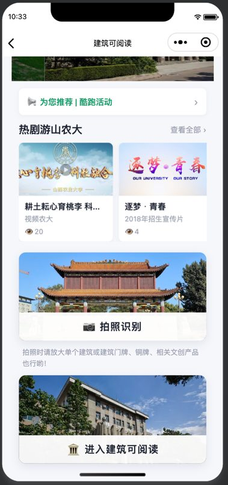
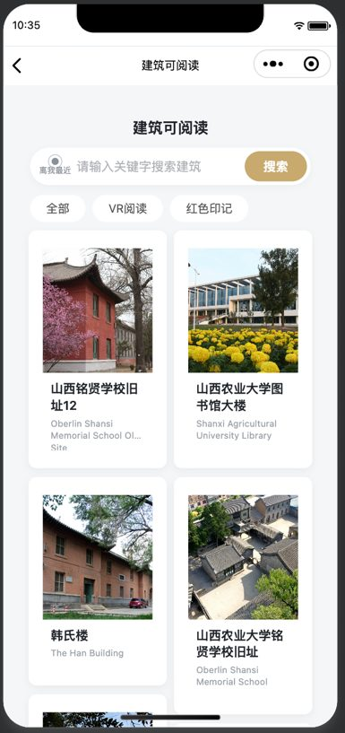
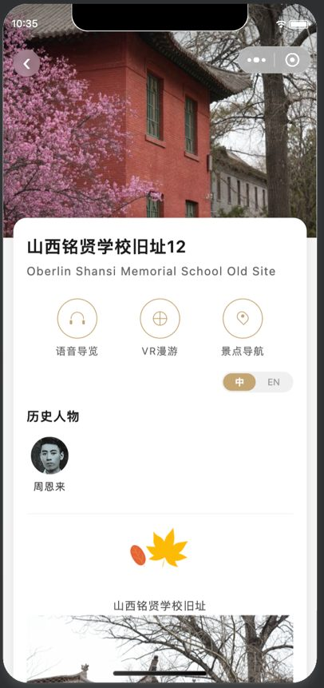
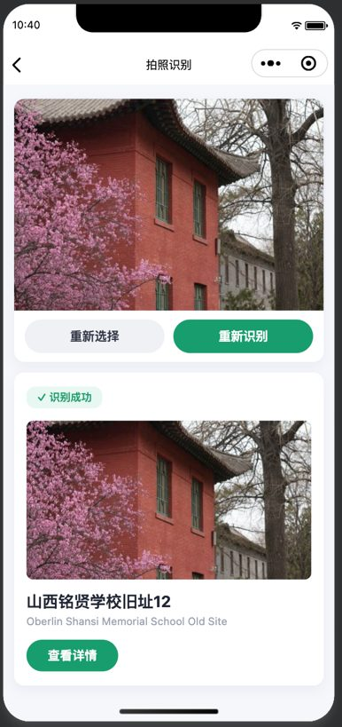
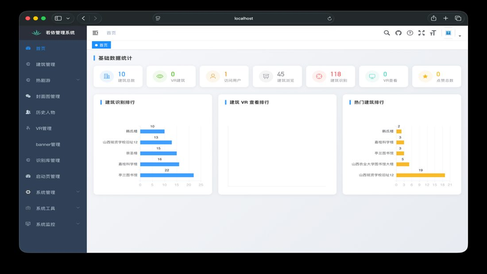
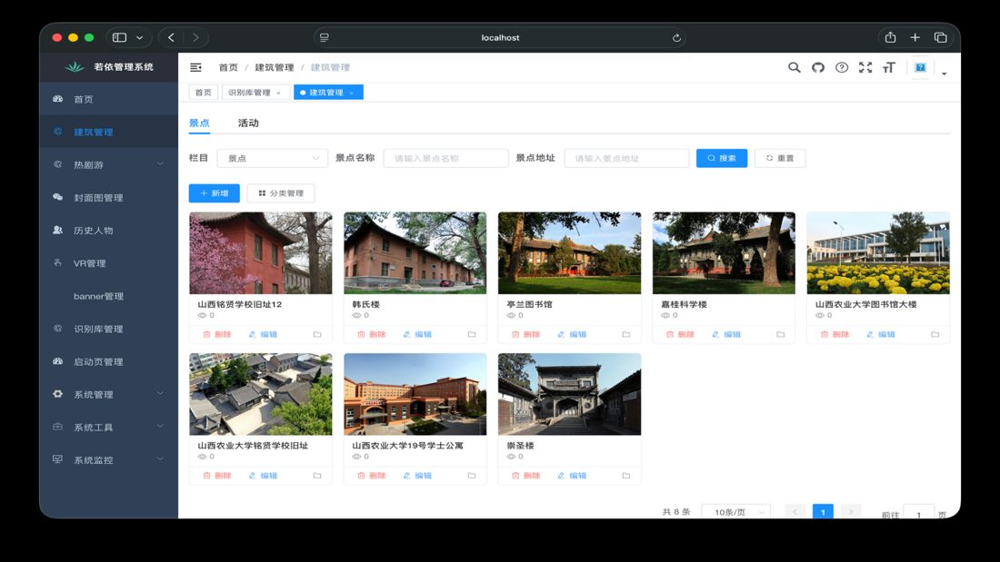

# SXAU AR Tourism Mini-Program

A full-stack AR campus-tourism application for Shanxi Agricultural University, built as a final-year software engineering project. Visitors explore the university's historic buildings ("readable buildings") through a WeChat mini-program with audio guides, VR panoramas and photo recognition, while staff manage all content through a web admin console.

## Screenshots

**WeChat mini-program (visitor side)**

   

**Admin console (staff side)**

 

## Features

**WeChat mini-program (visitor side)**
- Home page with banners, recommendations and featured video content
- Attraction ("readable building") list with keyword search and category filtering (VR reading / red-heritage sites)
- Attraction detail pages: photo carousel, audio guide, VR panorama, map navigation, related historical figures, Chinese/English toggle
- Photo recognition of landmarks, with a browsable recognition library
- VR panoramic tours and video playback
- Event list and detail pages

**Admin console (staff side)**
- Attraction, event, announcement and category management
- VR content, historical-figure and recognition-library management
- Featured-content ("hot drama tour") and banner management
- Dashboard statistics (content counts, category and VR charts)

## Architecture

```
┌────────────────────┐      ┌────────────────────┐
│  WeChat Mini       │      │  Admin Console     │
│  Program (native)  │      │  Vue 2 + ElementUI │
└─────────┬──────────┘      └─────────┬──────────┘
          │  REST / JSON              │  REST / JSON
          └────────────┬──────────────┘
                       ▼
          ┌─────────────────────────┐
          │  Spring Boot backend    │
          │  travel module (custom) │──► Redis (cache / sessions)
          │  RuoYi framework layer  │
          └────────────┬────────────┘
                       ▼
                 MySQL 8.0 (30+ tables)
```

## Tech stack

- **Mini-program:** native WeChat Mini Program (WXML / WXSS / JavaScript)
- **Admin console:** Vue 2 + Element UI
- **Backend:** Java, Spring Boot + MyBatis, REST API — custom `travel` business module (112 Java files, 12 controllers)
- **Database:** MySQL 8.0 · **Cache:** Redis

## What I built

The backend and admin console are built on the open-source [RuoYi](https://gitee.com/y_project/RuoYi-Vue) framework (the `ruoyi-*` modules are upstream). Designed and developed for this project:

- The `travel` business module — attractions, events, announcements, categories, VR content, historical figures, recognition library, banners, dashboard statistics, and the WeChat-facing APIs (`WxPortal`, `WxData`, `WxMaUser` controllers)
- The entire WeChat mini-program (14 page modules)
- The admin console's content-management views
- The MySQL schema and seed data (`backend/read_building.sql`, 30+ tables)

## Project structure

```
├── miniprogram/   # WeChat mini-program front end
├── admin-web/     # Vue 2 admin console
├── backend/       # Spring Boot backend
│   ├── travel/            # custom tourism business module
│   ├── ruoyi-admin/       # application entry point
│   ├── ruoyi-framework/   # RuoYi framework modules
│   ├── ruoyi-system/
│   ├── ruoyi-common/
│   └── read_building.sql  # database schema and seed data
└── docs/screenshots/
```

## Getting started

1. **Database** — create a MySQL 8.0 database and import the schema:
   ```bash
   CREATE DATABASE read_building DEFAULT CHARACTER SET utf8mb4;
   mysql -u root -p read_building < backend/read_building.sql
   ```
2. **Backend** — set your database credentials in `backend/ruoyi-admin/src/main/resources/application-druid.yml`, then run:
   ```bash
   cd backend && mvn spring-boot:run -pl ruoyi-admin   # serves on port 8020
   ```
3. **Admin console**:
   ```bash
   cd admin-web && npm install && npm run dev          # serves on port 1024
   ```
4. **Mini-program** — open `miniprogram/` in WeChat DevTools and set `baseUrl` in `config/env.js` to your backend address.

## Author

Bowen Duan — B.Eng. Software Engineering (Mobile Internet Applications), Shanxi Agricultural University.

## License

MIT. The RuoYi framework modules retain their original MIT license and copyright.
